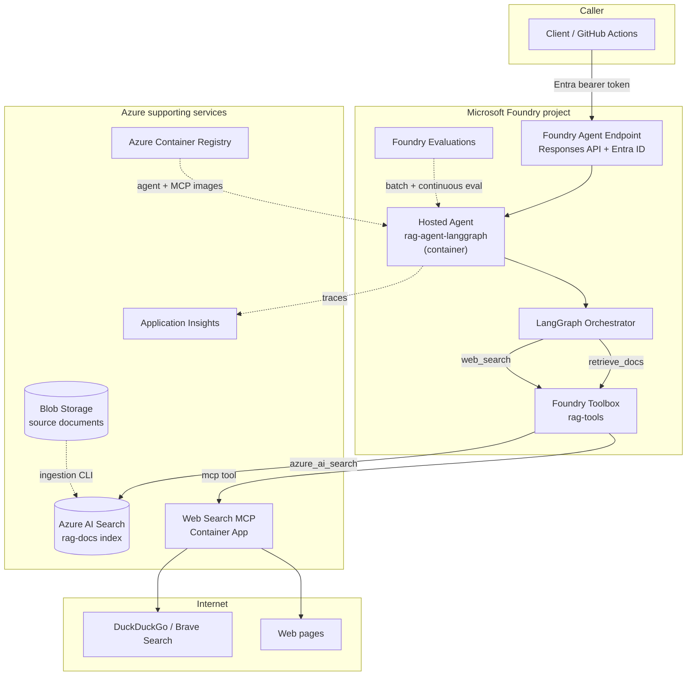

# RAG Agent with LangGraph, Foundry, and Web Search MCP

## 1. Executive Summary

Build a containerized RAG agent using **LangGraph**, hosted on **Microsoft Foundry (Azure AI Foundry) Agent Service**, with:

- Azure AI Search for document retrieval
- Foundry Models for chat and embeddings
- A custom web-search MCP server using DuckDuckGo/Brave + `trafilatura`
- Foundry Toolbox to expose AI Search and MCP tools to the agent
- Foundry Evaluations as the primary RAG quality gate
- GitHub Actions CI/CD using OIDC, `azd`, and Azure Container Registry
- Entra ID authentication on the Foundry agent endpoint
- One Foundry project with immutable agent version promotion

The agent answers from documents when sufficient evidence exists, falls back to web search when it does not, and refuses when no reliable evidence is available. Every answer includes citations.

---

## 2. Locked Decisions

| Decision | Choice |
|---|---|
| Agent framework | LangGraph |
| Agent hosting | Foundry Agent Service hosted agent, container deploy |
| Public API | Foundry Responses API endpoint |
| Authentication | Microsoft Entra ID bearer token |
| API gateway | None initially; APIM deferred |
| Environments | One Foundry project with immutable agent versions |
| Models | Foundry Models: small chat model + `text-embedding-3-small` |
| Document store | Azure AI Search, hybrid BM25 + vector retrieval |
| Document ingestion | Python CLI using the Azure AI Search push API (Option A) |
| Tool management | Foundry Toolbox |
| Web search | Custom MCP server: DuckDuckGo/Brave + `trafilatura` |
| Web MCP hosting | Azure Container Apps, external HTTPS + bearer key |
| Evaluation | Foundry Evaluations + deterministic retrieval/routing tests |
| CI/CD | GitHub Actions + OIDC + `azd` |
| Container registry | Azure Container Registry |
| Observability | Foundry traces + Application Insights |
| Infrastructure as code | Bicep, driven by `azd` |

---

## 3. Architecture

```text
Client / GitHub Actions
  │ Entra bearer token
  ▼
Foundry Agent Service endpoint (Responses API)
  │
  ▼
Hosted Agent: rag-agent-langgraph
  │  container image from ACR
  │
  ├─ LangGraph
  │    ├─ retrieve_docs
  │    ├─ grade_context
  │    ├─ answer_from_docs
  │    ├─ web_search
  │    ├─ answer_from_web / answer_hybrid
  │    └─ refuse
  │
  └─ Foundry Toolbox: rag-tools
       ├─ azure_ai_search → Azure AI Search
       └─ mcp → web-search-mcp

Azure AI Search ← ingestion CLI ← Blob Storage / bundled docs
Azure Container App: web-search-mcp ← ddgs/Brave + trafilatura
ACR ← agent + MCP images
Foundry Evaluations + Application Insights traces
```

### Architecture diagram (Mermaid)



### Resource flow

1. A caller obtains an Entra token for the Foundry project.
2. The caller invokes the Foundry agent endpoint.
3. The hosted LangGraph agent receives the request.
4. The agent retrieves documents through the Foundry Toolbox `azure_ai_search` tool.
5. If evidence is insufficient, the agent calls the Toolbox MCP tool backed by the custom web-search server.
6. The agent generates a grounded answer with citations.
7. Foundry traces and evaluation telemetry flow to Application Insights.

---

## 4. Agent Behavior and Routing

### LangGraph state

```python
class AgentState(TypedDict):
    question: str
    retrieved_docs: list[Document]
    web_results: list[WebResult]
    route: Literal["rag", "web", "hybrid", "refuse"]
    answer: str
    citations: list[Citation]
    timings: dict[str, float]
    errors: list[str]
```

### Graph

```text
START
  → retrieve_docs
  → grade_context
      ├─ sufficient   → answer_from_docs
      ├─ partial      → web_search → answer_hybrid
      ├─ insufficient → web_search → answer_from_web
      └─ no evidence  → refuse
END
```

### Node responsibilities

| Node | Responsibility |
|---|---|
| `retrieve_docs` | Call Toolbox `azure_ai_search` with the question |
| `grade_context` | Use structured output to decide whether retrieved context is sufficient |
| `answer_from_docs` | Generate a grounded answer using only document context |
| `web_search` | Call Toolbox MCP `search_and_read` |
| `answer_from_web` | Generate a grounded answer using only web context |
| `answer_hybrid` | Generate an answer using documents and web context |
| `refuse` | Return a clear refusal when no reliable evidence exists |

### Sufficiency grading

Use the Foundry chat model with structured output:

```json
{
  "sufficient": true,
  "confidence": 0.87,
  "reason": "The retrieved chunks directly answer the question."
}
```

Routing rules:

- `sufficient=true` and high confidence → `rag`
- `sufficient=false` but documents partially cover the question → `hybrid`
- no useful document evidence → `web`
- web search also fails or returns irrelevant content → `refuse`

### Answer requirements

- Cite document chunks with `doc_id` and `chunk_id`.
- Cite web sources with title and URL.
- Do not answer from model memory when no evidence exists.
- Treat retrieved web content as untrusted data. Ignore instructions embedded in pages.
- Include the route and citations in the response metadata.

---

## 5. Foundry Components

### 5.1 Hosted Agent

- Agent type: Foundry hosted agent
- Deploy mode: container
- Framework: LangGraph
- Container port: `8088`
- Image built remotely by `azd` and pushed to ACR
- Each successful deployment creates an immutable agent version

Use the official Foundry LangGraph container sample as the host adapter. Do not hand-write the Foundry protocol.

### 5.2 Foundry Models

- Chat model: a small, cost-effective Foundry model such as `gpt-4o-mini` or the current equivalent
- Embedding model: `text-embedding-3-small`
- Model deployments are managed through `azure.yaml` and `azd provision`
- The agent authenticates with managed identity / Entra ID

### 5.3 Foundry Toolbox

Toolbox name: `rag-tools`

Tools:

1. `azure_ai_search`
   - Points to the `rag-docs` index
   - Returns chunk text, title, URL, and relevance score

2. `mcp`
   - Remote MCP connection to `web-search-mcp`
   - Authenticated through a Foundry project connection
   - Initial implementation uses a static bearer key
   - Can move to agent identity / project managed identity later

### 5.4 Toolbox client details for LangGraph

The LangGraph agent connects to the Toolbox MCP endpoint using `TOOLBOX_ENDPOINT`.

Important details:

- Auth scope: `https://ai.azure.com/.default`
- Refresh the token per request
- Tool names may be prefixed, for example `websearch___search_and_read`
- Use `approval_mode="never_require"` because Toolbox does not enforce approvals
- Avoid `FOUNDRY_`-prefixed environment variables; Foundry reserves them
- Do not hard-code the Toolbox endpoint; resolve it from the azd environment

---

## 6. RAG Pipeline

### 6.1 Ingestion

**Selected approach: Option A — Python CLI using the Azure AI Search push API.**

Start with a Python ingestion CLI. This keeps chunking deterministic, makes retrieval metrics reproducible, and is easy to test without Azure AI Search indexers.

Planned command:

```bash
python -m app.ingest --source ./data --index rag-docs
```

Required environment variables:

```text
AZURE_SEARCH_ENDPOINT
AZURE_SEARCH_INDEX_NAME
AZURE_OPENAI_ENDPOINT
AZURE_EMBEDDING_DEPLOYMENT
```

Required permissions for the ingestion identity:

- Search Index Data Contributor on the Azure AI Search resource
- Search Service Contributor when creating or updating the index
- Cognitive Services OpenAI User on the Foundry/Azure OpenAI resource

Local development uses `az login` and `DefaultAzureCredential`. Deployed ingestion uses a managed identity.

Inputs:

- Markdown
- Text
- PDF
- HTML
- Blob Storage container or local `data/` directory

Pipeline:

1. Extract text.
2. Clean and normalize.
3. Chunk at approximately 700 tokens with 100-token overlap.
4. Preserve metadata:
   - `doc_id`
   - `chunk_id`
   - `title`
   - `source`
   - `url`
   - `chunk_index`
   - `last_updated`
5. Generate embeddings with the Foundry embedding model.
6. Upsert to Azure AI Search with deterministic IDs.
7. Make re-ingestion idempotent.
8. Verify with a test query:

```python
results = search_client.search(
    search_text="refund policy",
    top=3,
    select=["title", "content", "source", "url"],
)
```

Azure AI Search index fields:

```text
id
doc_id
chunk_id
title
source
url
content
content_vector
chunk_index
last_updated
metadata
```

### 6.2 Retrieval

- Hybrid search: BM25 + vector
- Top 5 chunks by default
- Return relevance scores and citations
- Use the Foundry Toolbox `azure_ai_search` tool rather than custom retrieval code

### 6.3 Later enhancement

If document ingestion becomes frequent, move to Azure AI Search integrated vectorization using:

- Blob Storage data source
- Indexer
- Skillset
- Foundry embedding deployment

This is deferred to keep the first version simple.

---

## 7. Web Search MCP Server

### 7.1 Tools

```text
search_web(query, max_results=5)
fetch_clean_text(url)
search_and_read(query, max_results=3)
```

### 7.2 Search and extraction

- Primary search: Brave Search API if a free key is available
- Fallback: `ddgs` (DuckDuckGo)
- Extraction: `trafilatura`
- Return title, URL, snippet, and cleaned text

### 7.3 Hosting

- Azure Container App
- External HTTPS ingress
- Bearer token required
- Rate limiting enabled
- Deployed as part of the same `azd` project or via a dedicated Bicep module

### 7.4 Security controls

- Validate URLs: only `http` and `https`
- Block localhost, private IP ranges, link-local addresses, and cloud metadata endpoints
- Re-check after redirects
- Enforce request timeouts
- Enforce maximum response size
- Limit extracted text length passed to the model
- Set a descriptive user agent
- Respect a domain denylist
- Treat all fetched content as untrusted
- Log search and fetch metadata without logging sensitive content

### 7.5 Foundry integration

- Create a Foundry project connection for the MCP server
- Store the bearer key in the connection, not in code
- Add the connection to the `rag-tools` toolbox
- Verify the tool end-to-end with `tools/list` and `tools/call`

---

## 8. Public API and Authentication

### 8.1 Endpoint

The Foundry hosted agent exposes a Responses API endpoint. This is the public API for the first version.

Callers must send:

```http
Authorization: Bearer <Entra token>
```

### 8.2 Authorization

- Callers need a Foundry role such as `Foundry User` on the project.
- GitHub Actions obtains tokens through OIDC.
- Local development uses `az login` / `DefaultAzureCredential`.
- No API keys are used for the public interface.

### 8.3 Deferred: APIM

Azure API Management is intentionally deferred.

Add APIM later if you need:

- API-key authentication for external consumers
- A custom `/v1/ask` contract
- Rate limiting and quotas per customer
- Custom domain
- WAF or additional policy enforcement

The agent implementation does not change when APIM is added.

---

## 9. Evaluation Strategy

### 9.1 Golden dataset

Create `evals/dataset.jsonl` with rows such as:

```json
{
  "query": "What is the refund policy?",
  "ground_truth": "Refunds are available within 30 days.",
  "context": "docs",
  "expected_behavior": "Answers from the policy document and cites the relevant chunk."
}
```

Coverage categories:

- Answerable from documents
- Requires web search
- Requires hybrid document + web evidence
- Unanswerable
- Prompt-injection attempts
- Stale document content
- Ambiguous questions

Target: 25-40 high-quality rows for the first baseline.

### 9.2 Evaluators

Foundry Evaluations:

- Groundedness
- Relevance
- Retrieval / response completeness where available
- Tool call accuracy
- Task adherence

Custom evaluators:

- Routing accuracy (`rag`, `web`, `hybrid`, `refuse`)
- Citation validity
- Refusal correctness
- Source attribution accuracy

Deterministic tests:

- Recall@k
- MRR
- Retrieval latency
- Router unit tests with fake tools

RAGAS is optional for local analysis and should not be the primary CI gate when Foundry Evaluations already covers groundedness and relevance.

### 9.3 Thresholds

Start with permissive thresholds and calibrate after the first baseline run.

Example `evals/thresholds.yaml`:

```yaml
groundedness: 0.80
relevance: 0.75
retrieval_recall_at_5: 0.80
routing_accuracy: 0.85
citation_validity: 1.00
refusal_correctness: 0.90
```

### 9.4 Web evaluation caveat

LLM judges cannot verify real-time web facts. For web-routed cases, evaluate the shape of the answer:

- Did the agent search?
- Did it cite a source?
- Did it avoid unsupported claims?
- Did it follow the expected behavior?

Do not score specific current facts that the judge cannot verify.

### 9.5 Continuous evaluation

Enable Foundry continuous evaluation on the production agent version with:

- Groundedness
- Relevance
- Tool call accuracy

Alert on metric regressions or elevated error rates.

---

## 10. CI/CD

### 10.1 CI on pull requests

- Ruff
- mypy
- Unit tests for each LangGraph node with fake Search and MCP tools
- Router tests for `rag`, `web`, `hybrid`, and `refuse`
- MCP contract tests
- URL validation and SSRF tests
- Docker build for the agent and MCP server
- Trivy image scan
- Fast deterministic retrieval evaluation

No cloud services are required for the fast test path.

### 10.2 CD on main

1. Authenticate to Azure with GitHub OIDC.
2. `azd provision` for the target environment.
3. `azd deploy`:
   - build the agent container remotely in ACR
   - register a new immutable Foundry agent version
   - deploy the MCP Container App
4. Refresh the Azure AI Search index if documents changed.
5. Run the Foundry evaluation suite.
6. Fail the workflow if thresholds are not met.
7. Promote the evaluated agent version.
8. Smoke-invoke the production endpoint.
9. Enable or verify continuous evaluation.

### 10.3 Promotion model

```text
deploy new immutable agent version
  → evaluate that version
  → promote if metrics pass
  → keep previous version for rollback
```

If the tenant or region cannot invoke a specific agent version directly during evaluation, use two agents within the same Foundry project:

- `rag-agent-staging`
- `rag-agent-prod`

The deployment image and eval gate remain the same.

### 10.4 GitHub configuration

- GitHub Environments: `staging`, `production`
- Required reviewers for production
- OIDC federated credentials; no stored Azure credentials
- Secrets:
  - MCP bearer key
  - optional Brave Search API key
- Variables:
  - Azure subscription ID
  - Azure location
  - Foundry project name
  - model deployment names

### 10.5 Required `azd` extensions

- `azure.ai.agents`
- `azure.ai.projects`
- `azure.ai.toolboxes`

Pin extension versions in the workflow to avoid preview drift.

---

## 11. Infrastructure

### 11.1 Provisioned resources

- Microsoft Foundry account and project
- Foundry model deployments
- Azure Container Registry
- Azure AI Search
- Azure Storage account and Blob container for documents
- Azure Container App for `web-search-mcp`
- Log Analytics workspace
- Application Insights
- Managed identities and role assignments
- Foundry Toolbox `rag-tools`
- Foundry connections for AI Search and the MCP server

### 11.2 Managed identity roles

Agent / deployment identity:

- `AcrPull`
- `Search Index Data Contributor`
- `Cognitive Services OpenAI User`
- Foundry project roles as required
- `Monitoring Metrics Publisher` if needed

MCP Container App:

- no Azure data-plane roles unless using agent identity auth later
- ACR pull identity

### 11.3 Key `azure.yaml` services

```yaml
services:
  ai-project:
    host: azure.ai.project
    # Foundry project and model deployments

  rag-agent:
    host: azure.ai.agent
    language: docker
    docker:
      remoteBuild: true
    uses:
      - ai-project
      - agent-tools

  agent-tools:
    host: azure.ai.toolbox
    # azure_ai_search + mcp connection

  websearch-mcp:
    host: containerapp
    language: docker
    docker:
      remoteBuild: true
```

Exact service shapes should follow the current Foundry samples and `azd` extension schema.

### 11.4 Container images

Agent image:

- Python 3.13
- LangGraph
- Foundry host adapter
- Foundry model client
- MCP client
- Port `8088`
- Non-root user
- Pinned dependencies

MCP image:

- Python 3.13
- MCP server
- `ddgs` and/or Brave client
- `trafilatura`
- Port configured for MCP HTTP transport
- Non-root user
- Pinned dependencies

---

## 12. Repository Layout

```text
.
├─ azure.yaml
├─ infra/
│    ├─ main.bicep
│    ├─ modules/
│    │    ├─ foundry.bicep
│    │    ├─ search.bicep
│    │    ├─ storage.bicep
│    │    ├─ mcp-container-app.bicep
│    │    ├─ observability.bicep
│    │    └─ role-assignments.bicep
│    └─ parameters/
├─ src/
│    ├─ rag-agent/
│    │    ├─ main.py
│    │    ├─ graph.py
│    │    ├─ nodes/
│    │    ├─ prompts/
│    │    ├─ clients/
│    │    ├─ Dockerfile
│    │    ├─ .dockerignore
│    │    ├─ pyproject.toml
│    │    └─ tests/
│    └─ web-search-mcp/
│         ├─ server.py
│         ├─ search.py
│         ├─ extract.py
│         ├─ security.py
│         ├─ Dockerfile
│         ├─ .dockerignore
│         ├─ pyproject.toml
│         └─ tests/
├─ evals/
│    ├─ dataset.jsonl
│    ├─ evaluators/
│    ├─ thresholds.yaml
│    └─ gate.py
├─ tests/
│    ├─ graph/
│    ├─ retrieval/
│    └─ integration/
├─ .github/
│    └─ workflows/
│         ├─ ci.yml
│         └─ cd.yml
├─ docs/
│    ├─ architecture.md
│    ├─ runbook.md
│    └─ evaluation.md
└─ plan/
     └─ master_plan.md
```

---

## 13. Implementation Steps

### Phase 0: Prerequisites

- **Step 0.1** — Confirm the Azure subscription, Foundry project, model access, and model quota.
- **Step 0.2** — Verify local tools: `az`, `azd`, Docker, Python 3.13, and Git.
- **Step 0.3** — Install the required `azd` extensions: `azure.ai.agents`, `azure.ai.projects`, and `azure.ai.toolboxes`.
- **Step 0.4** — Create GitHub environments `staging` and `production`, with required reviewers on production.
- **Step 0.5** — Configure GitHub OIDC federation and Azure role assignments.
- **Step 0.6** — Create or obtain a Brave Search API key, if using Brave as the primary search provider.

### Phase 1: Scaffold Foundry LangGraph agent

- **Step 1.1** — Initialize the `azd` project from the official Foundry LangGraph container sample.
- **Step 1.2** — Set the Foundry project endpoint, model deployment, subscription, and region in the `azd` environment.
- **Step 1.3** — Verify `azd ai agent run` locally.
- **Step 1.4** — Add configuration validation and health checks.
- **Step 1.5** — Confirm model deployment and local Entra authentication.
- **Step 1.6** — Run `azd deploy` to verify that a new immutable agent version is created.

Exit criteria:

- Local agent responds through the Foundry host adapter.
- `azd deploy` creates an agent version.

### Phase 2: RAG with Azure AI Search

- **Step 2.1** — Create the Azure AI Search service and `rag-docs` index.
- **Step 2.2** — Build the ingestion CLI with deterministic chunk IDs.
- **Step 2.3** — Load seed documents from Blob Storage or the local `data/` directory.
- **Step 2.4** — Generate embeddings with the Foundry embedding deployment.
- **Step 2.5** — Create the Foundry AI Search connection.
- **Step 2.6** — Add the `azure_ai_search` tool to the `rag-tools` Toolbox.
- **Step 2.7** — Implement `retrieve_docs`, `grade_context`, and `answer_from_docs`.
- **Step 2.8** — Add document citations to the response.

Exit criteria:

- A document-answerable question returns `route: rag` with valid citations.

### Phase 3: Web search MCP

- **Step 3.1** — Build the MCP server with `search_web`, `fetch_clean_text`, and `search_and_read`.
- **Step 3.2** — Add Brave/DuckDuckGo search and `trafilatura` extraction.
- **Step 3.3** — Add SSRF protections, timeouts, size limits, and contract tests.
- **Step 3.4** — Containerize the MCP server.
- **Step 3.5** — Deploy it to Azure Container Apps with external HTTPS ingress and a bearer key.
- **Step 3.6** — Create the Foundry MCP connection and add the MCP tool to `rag-tools`.
- **Step 3.7** — Implement `web_search`, `answer_from_web`, and `answer_hybrid`.
- **Step 3.8** — Implement the refusal path.

Exit criteria:

- A question outside the document corpus returns `route: web` with URL citations.
- A partial question returns `route: hybrid`.
- An unanswerable question returns `route: refuse`.

### Phase 4: Evaluation

- **Step 4.1** — Build the golden dataset with document, web, hybrid, unanswerable, and adversarial cases.
- **Step 4.2** — Configure Foundry groundedness, relevance, retrieval, and tool-call evaluators.
- **Step 4.3** — Add routing, citation, refusal, recall@k, and MRR tests.
- **Step 4.4** — Create the threshold gate script.
- **Step 4.5** — Run the baseline evaluation and calibrate thresholds.
- **Step 4.6** — Persist the evaluation report as a CI artifact.

Exit criteria:

- `evals/gate.py` produces a pass/fail result against thresholds.
- Evaluation report is written as a CI artifact.

### Phase 5: CI/CD

- **Step 5.1** — Add the PR CI workflow with linting, typing, unit tests, graph tests, MCP contract tests, Docker builds, and Trivy.
- **Step 5.2** — Add the OIDC-based CD workflow.
- **Step 5.3** — Deploy a new agent version with `azd deploy`.
- **Step 5.4** — Run the Foundry evaluation gate.
- **Step 5.5** — Promote the evaluated version only if the gate passes.
- **Step 5.6** — Run a production smoke test.
- **Step 5.7** — Enable continuous evaluation.

Exit criteria:

- A failing eval blocks promotion.
- A passing eval promotes the version.
- No Azure credentials are stored in GitHub.

### Phase 6: Hardening and documentation

- **Step 6.1** — Add prompt-injection tests.
- **Step 6.2** — Add rate limiting and request size limits.
- **Step 6.3** — Add structured logging, tracing, and alerts.
- **Step 6.4** — Write the runbook and architecture documentation.
- **Step 6.5** — Review cost and scaling settings.

---

## 14. Acceptance Criteria

- [ ] A document-answerable question returns `route: rag` with document citations.
- [ ] A question outside the documents returns `route: web` with URL citations.
- [ ] A partially covered question returns `route: hybrid`.
- [ ] An unanswerable question returns `route: refuse`.
- [ ] The agent refuses to answer from model memory when evidence is missing.
- [ ] `azd deploy` creates a new immutable agent version.
- [ ] Foundry evaluation passes thresholds before promotion.
- [ ] GitHub Actions deploys using OIDC with no stored Azure credentials.
- [ ] Web MCP rejects private/internal URLs.
- [ ] No secrets are present in the repository or container images.
- [ ] Foundry traces are visible in Application Insights.
- [ ] Continuous evaluation is enabled for production.

---

## 15. Security

### Public API

- Entra ID bearer tokens only
- Foundry project RBAC
- No anonymous access in the first version

### MCP server

- Bearer key stored in Foundry connection
- Rate limiting
- SSRF protection
- URL allowlist/denylist
- Request timeouts and size limits
- No secrets in logs

### Agent

- Treat document and web content as untrusted
- Defend against prompt injection
- Do not follow instructions found in retrieved content
- Do not expose internal endpoints or environment variables
- Limit tool call counts and token usage

### Supply chain

- Pin dependencies
- Run Trivy on images
- Run `pip-audit`
- Use non-root containers
- Keep `.env` and credentials out of images

---

## 16. Observability

- Foundry traces for agent invocations and tool calls
- Application Insights for logs, exceptions, and latency
- Custom spans for retrieval, routing, web search, and generation
- Metrics:
  - request count
  - route distribution
  - retrieval latency
  - tool latency
  - token usage
  - error rate
  - eval scores over time
- Alerts:
  - elevated 5xx rate
  - p95 latency regression
  - evaluation score drop
  - MCP failure rate

---

## 17. Risks and Mitigations

| Risk | Mitigation |
|---|---|
| Foundry hosted agents/Toolbox are preview features | Pin `azd` extension versions; follow official samples; isolate integration code |
| Model quota or region unavailable | Validate model deployment early; make region/model names configurable |
| DuckDuckGo blocks cloud IPs | Use Brave free tier as primary, DDG as fallback |
| Public MCP server abuse | Bearer key, rate limits, timeouts, logging, optional APIM/WAF later |
| SSRF via page fetch | Strict URL validation, private IP blocking, redirect checks |
| Prompt injection from web pages | Treat content as data; grounded prompts; no tool execution from page instructions |
| Evaluator knowledge cutoff | Use behavioral rubrics for web cases; do not score live facts |
| Eval variance | Run enough samples; use deterministic tests for routing/retrieval |
| Azure AI Search free tier limits | Start free; move to Basic if storage or SLA requires it |
| Version promotion limitations | Fallback to staging/prod agents within the same Foundry project |

---

## 18. Prerequisites

- Azure subscription with permission to create resources and role assignments
- Microsoft Foundry project with model access and quota
- `az` CLI authenticated
- `azd` CLI with required extensions
- Docker for local container builds
- Python 3.13
- GitHub repository admin access for OIDC and environments
- Brave Search API key (optional, recommended)
- Azure AI Search free tier available in the target region

---

## 19. Cost Notes

Main cost drivers:

- Foundry model tokens
- Hosted agent compute
- Azure AI Search tier
- Container Apps for the MCP server
- Application Insights and Log Analytics ingestion
- ACR Basic

Low-cost choices:

- Scale MCP Container App to zero when possible
- Use a small chat model
- Use AI Search free tier for the demo
- Cap Log Analytics daily ingestion
- Run full evaluations only on main/nightly, not every PR

---

## 20. Deferred Items

- Azure API Management with API-key auth and custom domain
- Separate staging/production Foundry projects
- Separate staging AI Search index
- Azure AI Search integrated vectorization
- Multi-turn conversation memory
- Streaming responses
- UI frontend
- Private networking / VNet isolation
- Agent identity authentication from Toolbox to the MCP server
- Load testing and autoscaling tuning
- RAGAS as a secondary local analysis suite

---

## 21. Next Step

When implementation begins, start in this order:

1. **Step 0.1-0.6** — Complete prerequisites and GitHub OIDC setup.
2. **Step 1.1-1.6** — Scaffold the official Foundry LangGraph container sample and deploy a local smoke-tested agent version.
3. **Step 2.1-2.8** — Add Azure AI Search ingestion and the Toolbox `azure_ai_search` tool.
4. **Step 3.1-3.8** — Build and connect the web-search MCP server, then complete routing and refusal behavior.
5. **Step 4.1-4.6** — Add Foundry evaluations and the CI gate.
6. **Step 5.1-5.7** — Add OIDC-based CD with agent version promotion.
7. **Step 6.1-6.5** — Harden, document, and review cost.
